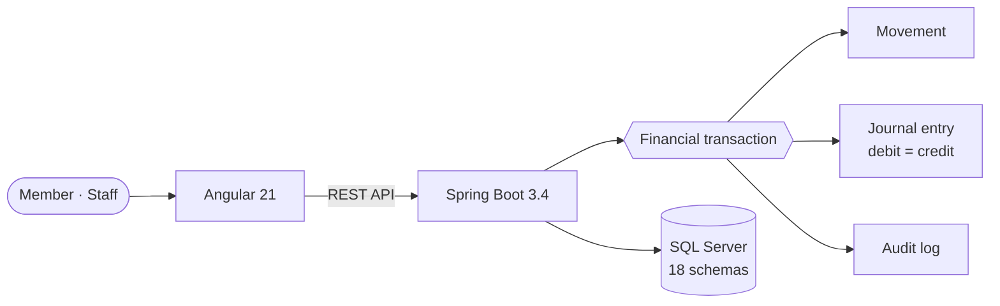
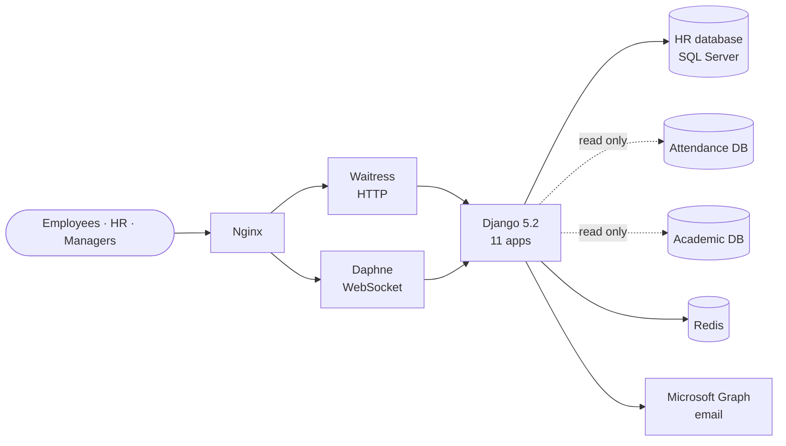
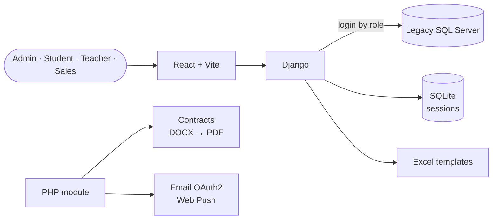
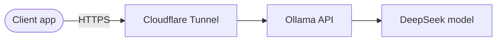
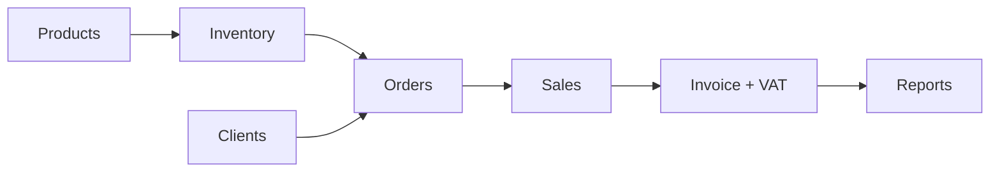
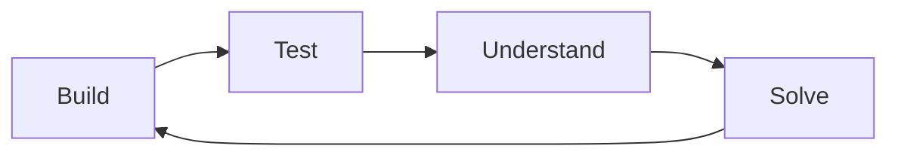

<h1 align="center">Apofis391</h1>

  <b>Computer Science Engineer · Full Stack Developer</b> 
  Universidad UTE · Pichincha, Ecuador

  

<table align="center">
  <tr>
    <td align="center" width="140"><h3>6</h3>systems built</td>
    <td align="center" width="140"><h3>6</h3>languages</td>
    <td align="center" width="140"><h3>4</h3>database engines</td>
    <td align="center" width="140"><h3>102</h3>automated tests in one project</td>
  </tr>
</table>

 

### About

Computer Science Engineer graduated from Universidad UTE, working as a full stack developer.
I design and deliver complete systems for real organizations — finance, education, human resources, retail and hospitality — covering the database, backend, frontend, server and deployment.
I also run my own infrastructure: Windows Server 2022 on Hetzner and a self‑hosted AI service published through Cloudflare.

**What I bring to a project**

| | |
|:--|:--|
| **Full stack delivery** | From the database schema to the screen the user clicks |
| **Data integrity** | Transactions, audit trails and double‑entry accounting where money is involved |
| **Security by default** | Role‑based access, encrypted fields, strict security headers, no secrets in code |
| **Quality** | Automated tests against the real database, static analysis and CI on every push |
| **Operations** | Servers, reverse proxies, tunnels, Docker and production checklists |

 

### Stack

| | |
|:--|:--|
| **Languages** | <picture><source media="(prefers-color-scheme: dark)" srcset="https://skillicons.dev/icons?i=java,python,php,js,ts,cs&theme=dark"></picture> |
| **Backend** | <picture><source media="(prefers-color-scheme: dark)" srcset="https://skillicons.dev/icons?i=spring,django,laravel,nodejs&theme=dark"></picture> |
| **Frontend** | <picture><source media="(prefers-color-scheme: dark)" srcset="https://skillicons.dev/icons?i=angular,react,vue,vite,tailwind,html,css&theme=dark"></picture> |
| **Databases** | <picture><source media="(prefers-color-scheme: dark)" srcset="https://skillicons.dev/icons?i=mysql,postgres,sqlite,redis&theme=dark"></picture> &nbsp;+ SQL Server (T‑SQL) |
| **Infrastructure** | <picture><source media="(prefers-color-scheme: dark)" srcset="https://skillicons.dev/icons?i=windows,linux,docker,nginx,cloudflare&theme=dark"></picture> &nbsp;+ Hetzner · Windows Server 2022 |
| **AI** | Ollama · DeepSeek (self‑hosted LLM) |
| **Tools** | <picture><source media="(prefers-color-scheme: dark)" srcset="https://skillicons.dev/icons?i=git,github,githubactions,powershell,vscode,idea&theme=dark"></picture> |

 

### Featured Projects

Click <b>Architecture</b> under each project to see how it is built.

---

#### FINTEC — Credit union core system
Manages members, savings, contributions, loans, transactions, accounting, audit and reports.

- **Money is never edited directly.** Every movement creates a transaction, a journal entry (debit = credit) and an audit record. Errors are fixed with reversals, never deletes.
- **Exact amounts.** No floating‑point numbers in financial calculations.
- **Loans** with German amortization, guarantor rules, PDF application and an approval workflow.
- **12 backend modules · 18 database schemas**, versioned migrations, BCrypt passwords, bulk user import from Excel and automatic logout after 15 minutes of inactivity.

<b>Architecture</b>

 

---

#### mi_rrhh — Human resources platform
Employee records, self‑service, vacations and absences, processes, hiring and a control dashboard for an educational institute.

- **11 modules:** accounts, credentials, employees, vacations, attendance, tasks, hiring, notifications, audit, dashboard and TIC teachers.
- **Security:** AES‑256‑GCM field encryption, strict Content Security Policy, protected file downloads, brute‑force protection and 8 roles with per‑object permissions.
- **Quality:** 102 automated tests against real SQL Server, CI with static analysis, coverage and dependency audit, and load tests with Locust.
- **Real time:** WebSocket notifications, web push and institutional email through Microsoft Graph.

<b>Architecture</b>

 

---

#### Intec Academic Platform
Role‑based academic system for an institute: separate dashboards for admin, students, teachers and sales; enrollment templates; teacher contracts.

- **Legacy integration:** logs users in against an existing SQL Server database without touching its tables.
- **Documents:** generates Excel enrollment templates and teacher contracts (DOCX → PDF).
- **Communication:** email with OAuth2 (Google, Microsoft, Yahoo) and web push notifications.
- **Data migration** scripts from SQL Server to PostgreSQL, and a Docker setup for development.

<b>Architecture</b>

 

---

#### Self‑hosted AI service
Private, self‑hosted LLM API running DeepSeek with Ollama, published to the internet through Cloudflare.

<b>Architecture</b>

 

---

#### HuecoUIO — Sales and inventory management
Business dashboard for products, inventory, clients, orders, sales, invoices with VAT and reports. Team project at Universidad UTE.

<b>Business flow</b>

 

[View repository →](https://github.com/ElHuecoUTE/huecoUIO_LaravelApp)

---

#### Hotel Oasis — Hotel website and back office
Public site with services, promotions, reservations and contact, plus a staff area for reservations, rooms, income and expenses, inventory, cleaning, staff and marketing.

Built on a custom MVC structure: own router, controllers, views and reusable partials.

---

#### Open source

| Repository | What it does | Built with |
|:--|:--|:--|
| [automatizacion-whassap](https://github.com/Apofis391/automatizacion-whassap) | Sends a task checklist as a WhatsApp poll and keeps reminding until every task is checked | Node.js · whatsapp‑web.js |
| [Certificados](https://github.com/Apofis391/Certificados) | Splits bulk PDFs into one file per certificate, reads them with OCR and flags missing ones | Python |
| [Java-MDNE](https://github.com/Apofis391/Java-MDNE) | Data structures and algorithms: AVL and binary search trees, queues, hash tables, Prim, knapsack | Java |

#### In design

| Project | Goal | Planned stack |
|:--|:--|:--|
| Cybersecurity Lab | Practice security in safe, simulated labs with levels, progress tracking and automatic reports | Angular · Java · SQL · Docker |
| Security & Network Quotes | Build professional quotes for cameras and network equipment from a product catalog | Angular · TypeScript · Java · SQL |
| Tech Store | Online catalog and store for cameras, networking gear and electronic components | Angular · TypeScript · SQL |
| Smart City 3D | Interactive 3D city to visualize traffic, lighting, IoT devices and network infrastructure | JavaScript · 3D web |

#### Side project
Tank combat game for Fortnite Creative, scripted in Verse (UEFN).

 

### GitHub Activity

  <picture>
    <source media="(prefers-color-scheme: dark)" srcset="./profile-summary-card-output/github_dark/3-stats.svg">
    
  </picture>
  <picture>
    <source media="(prefers-color-scheme: dark)" srcset="./profile-summary-card-output/github_dark/2-most-commit-language.svg">
    
  </picture>

  <picture>
    <source media="(prefers-color-scheme: dark)" srcset="https://streak-stats.demolab.com/?user=Apofis391&hide_border=true&background=00000000&ring=2997FF&fire=2997FF&currStreakNum=F5F5F7&sideNums=F5F5F7&currStreakLabel=F5F5F7&sideLabels=86868B&dates=86868B&stroke=3A3A3C">
    
  </picture>

  <picture>
    <source media="(prefers-color-scheme: dark)" srcset="https://raw.githubusercontent.com/Apofis391/Apofis391/output/github-snake-dark.svg">
    
  </picture>

 

### Currently Learning

  
  
  
  
  

 

### Learning Philosophy

> **Build to understand. Understand to solve.**
>
> I don't learn a technology by reading about it — I learn it by building something real with it.
> If I haven't built it, I can't truly solve it.

 

### Open Source & Collaboration

Open to collaborating on business systems, automation, self‑hosted AI and server infrastructure.
Issues, ideas and pull requests on my repositories are welcome.

[github.com/Apofis391](https://github.com/Apofis391)
